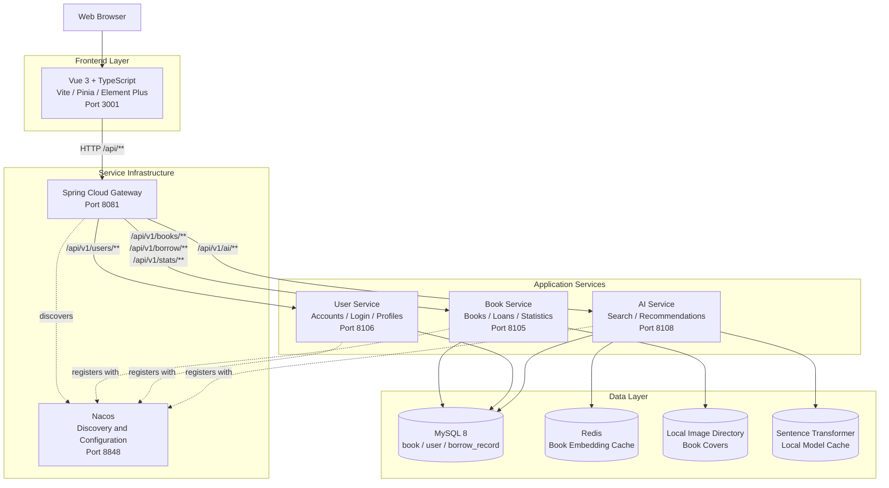
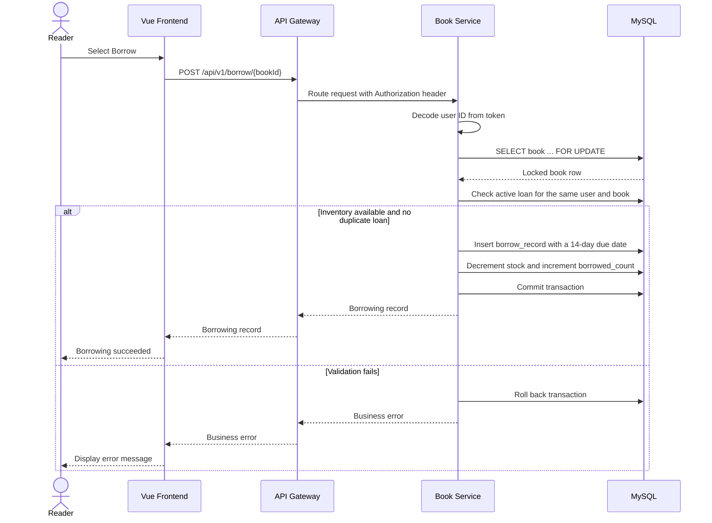
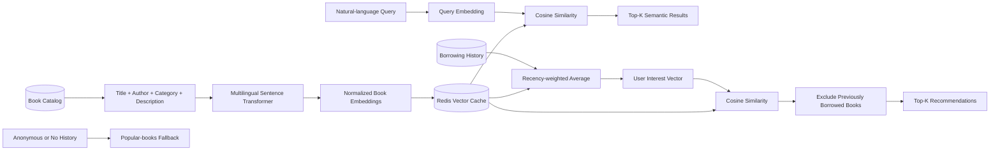

# System Architecture

This document describes the runtime architecture and the two main application
flows of the Intelligent Library Management System.

## Runtime Architecture

## Borrowing Transaction

The row lock and transaction keep the inventory check and stock update atomic,
preventing concurrent requests from borrowing the final copy more than once.

## Semantic Search and Recommendation Flow

Book embeddings are created during AI-service startup when no Redis cache is
available. Catalog changes do not currently invalidate the cache automatically;
call `POST /api/v1/ai/embeddings/rebuild` after significant book updates.

## Service Boundaries

| Component | Owns | Depends on |
| --- | --- | --- |
| Gateway | External API routing | Nacos and all application services |
| Book Service | Catalog, inventory, loans, dashboard data | MySQL and local cover storage |
| User Service | Accounts, login, profiles, user administration | MySQL |
| AI Service | Embeddings, semantic ranking, recommendations | MySQL, Redis, model cache, Nacos |
| Frontend | Reader and administrator workflows | Gateway |

## Security Boundary

The current authentication implementation is intended for an academic demo.
The token contains a Base64-encoded user ID and is not cryptographically signed.
Before production deployment, replace it with signed authentication, enforce
administrator authorization in the backend, use a modern password hash, and
move all credentials out of tracked configuration files.
